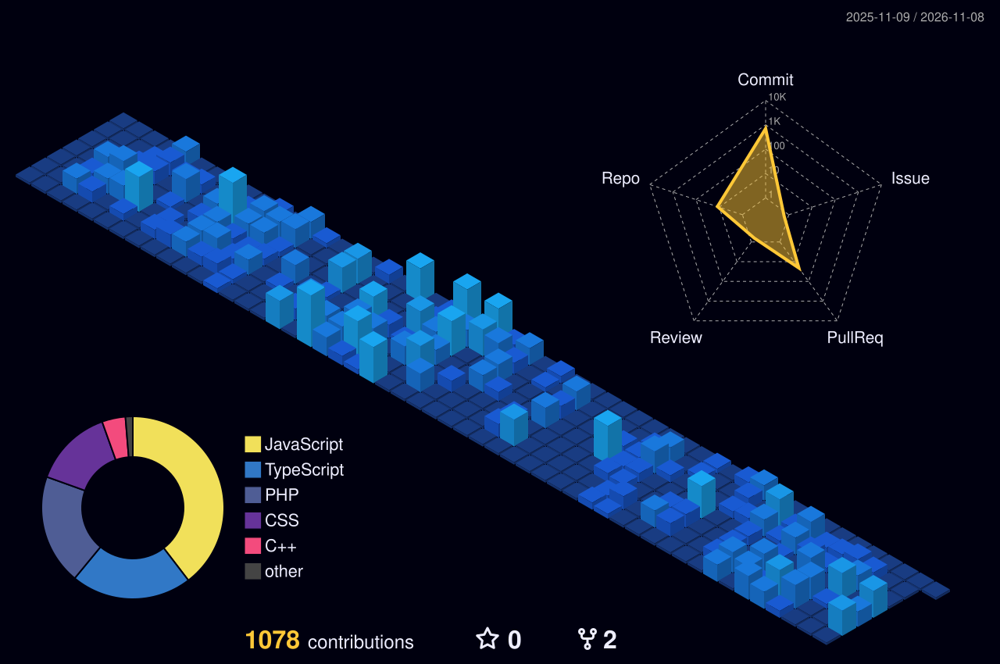

[Portfolio](https://chamikashashipriya.dev) · [LinkedIn](https://www.linkedin.com/in/chamika-shashipriya-722366321) · [Email](mailto:chamikashashipriya3@gmail.com)

### `chamika@github:~ $ cat about.txt`

Full-stack web developer and software engineering undergraduate from Ambalangoda, Sri Lanka. I build modern web applications and explore interactive 3D experiences.

**Currently building with** Next.js, React, Node.js, and Spring Boot.

**Exploring** Three.js, Framer Motion, and scalable application architectures.

### `chamika@github:~ $ ls projects/`

| Project | Description | Tech Stack | Repository |
| :--- | :--- | :--- | :---: |
| 🌐 **Modern 3D Portfolio** | Futuristic interactive 3D developer portfolio showcasing projects and animations. | `Next.js` `TypeScript` `Three.js` `Tailwind` | [View Repo](https://github.com/ChamikaShashipriya99/My-Portfolio-using-Next.js) |
| 📋 **RP Planner (J26-IT-302)** | Collaborative project and workflow planning tool engineered for research teams. | `C++` `Application` | [View Repo](https://github.com/ChamikaShashipriya99/RP-Planner-J26-IT-302) |
| 🎓 **Smart Campus PAF System** | Scalable enterprise campus management platform built for modern academic workflows. | `JavaScript` `Node.js` `Web` | [View Repo](https://github.com/ChamikaShashipriya99/it3030-paf-2026-smart-campus-group76) |
| 🎪 **Event Management System** | Enterprise event coordination and ticket/attendee handling software system. | `JavaScript` `Full-Stack` | [View Repo](https://github.com/ChamikaShashipriya99/Enterprises-Event-Management-System-ITPM-Group-Project) |
| 🏍️ **Yamaha MT-15 Service Hub** | Dedicated web portal for recording, managing, and monitoring motorcycle maintenance history. | `TypeScript` `React` `Web` | [View Repo](https://github.com/ChamikaShashipriya99/YAMAHA-MT15-Service-Recoard-Holding-WebSite) |
| 🌿 **GreenPulse IoT System** | Intelligent smart environmental monitoring and automation IoT platform. | `C++` `IoT` `Hardware/Cloud` | [View Repo](https://github.com/ChamikaShashipriya99/IOT-Assignment-GraeenPulse) |

### `chamika@github:~ $ cat stack.txt`

| Area | Technologies |
| :--- | :--- |
| Frontend | TypeScript, JavaScript, React, Next.js, Vue, Tailwind CSS |
| Backend | Node.js, Express, Java, Spring Boot, C#, .NET, PHP |
| Data | MySQL, MongoDB, Firebase |
| Creative & tools | Three.js, Framer Motion, Figma, Git, Linux, Vercel |

More activity · contribution snake and 3D graph

---

`$ echo "Learn • Build • Improve"`
