  <a href="https://chamikashashipriya.dev"></a>
  <a href="https://www.linkedin.com/in/chamika-shashipriya-722366321"></a>
  <a href="mailto:chamikashashipriya3@gmail.com"></a>



[](https://github.com/ChamikaShashipriya99/My-Portfolio-using-Next.js)

[](https://github.com/ChamikaShashipriya99/RP-Planner-J26-IT-302)

[](https://github.com/ChamikaShashipriya99/it3030-paf-2026-smart-campus-group76)

[](https://github.com/ChamikaShashipriya99/Enterprises-Event-Management-System-ITPM-Group-Project)

[](https://github.com/ChamikaShashipriya99/YAMAHA-MT15-Service-Recoard-Holding-WebSite)

[](https://github.com/ChamikaShashipriya99/IOT-Assignment-GraeenPulse)


<code>&gt; Open activity logs</code>



